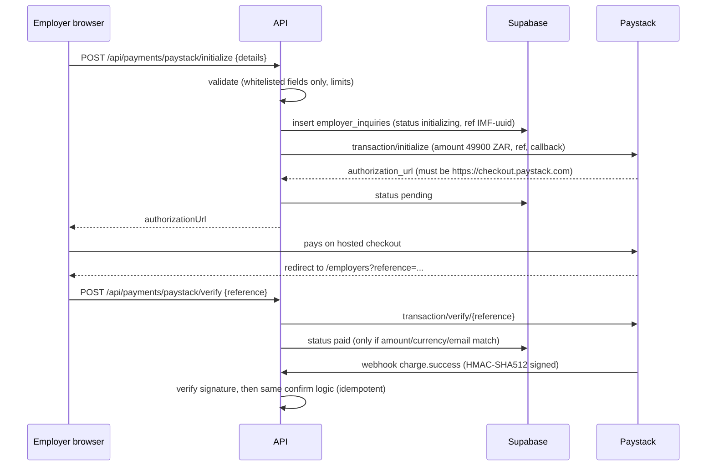

# IMFORCE Public Site — Project Documentation

| | |
|---|---|
| **System** | imforce.co.za public recruitment website, staff vacancy dashboard and employer job-order checkout |
| **Owner** | IMFORCE Talent Recruitment |
| **Repository** | `sne-imforce/imforce-public-site` |
| **Document status** | Living document. Update it in the same pull request as any change it describes. |
| **Last reviewed** | 12 November 2026 (QA and secure-SDLC review, round 2; see [QA_SECURITY_REVIEW.md](./QA_SECURITY_REVIEW.md)) |

---

## Contents

1. [Project scope](#1-project-scope)
2. [What is built today (and what is not)](#2-what-is-built-today-and-what-is-not)
3. [Tech stack](#3-tech-stack)
4. [External services and tools](#4-external-services-and-tools)
5. [Architecture](#5-architecture)
6. [Repository layout](#6-repository-layout)
7. [Frontend (website)](#7-frontend-website)
8. [Backend API reference](#8-backend-api-reference)
9. [Database](#9-database)
10. [Security architecture](#10-security-architecture)
11. [Intrusion detection and alarms](#11-intrusion-detection-and-alarms)
12. [Configuration (environment variables)](#12-configuration-environment-variables)
13. [Local development](#13-local-development)
14. [Testing](#14-testing)
15. [Secure SDLC and CI/CD](#15-secure-sdlc-and-cicd)
16. [Deployment](#16-deployment)
17. [Operations runbooks](#17-operations-runbooks)
18. [Known gaps and roadmap](#18-known-gaps-and-roadmap)
19. [Glossary](#19-glossary)

---

## 1. Project scope

The authoritative business scope is the internal document
[`docs/reference/IMFORCE_Website_Rebuild_Developer_Scope.docx`](./reference/IMFORCE_Website_Rebuild_Developer_Scope.docx)
(2 October 2026). It is internal: it was previously stored in the website's
`public/` folder, which made it downloadable by anyone. It has been moved here.

**Purpose.** Rebuild imforce.co.za as IMFORCE's public recruitment website and employer self-service portal, with **permanent staffing and placement** as the main message.

**Desired outcomes (from the scope).**

- Clear employer and candidate journeys around permanent placement.
- Employers submit complete job orders, accept an agreement, pay the activation fee and track jobs.
- Approved vacancies are published with search and filters. Candidates apply **once**, on the matching **Nexora AI** vacancy. The website does not collect CVs.
- The site stays independently deployable and can take job orders while connected systems are down.

**Key business rules.**

| Rule | Value |
|---|---|
| Activation fee | **R499 per job order**, regardless of the number of hires. VAT treatment still to be confirmed by IMFORCE Finance. |
| Activation fee credit | Credited against the first permanent-placement invoice if a placement happens |
| Hold or cancel | Fee forfeited. A hold longer than 90 days needs a new R499 to restart. |
| Placement fee (calculator) | 10% of annual CTC (monthly salary × 12), payable in 12 monthly instalments, per successful hire |
| Advert approval | Payment does **not** publish an advert. An authorised staff member must approve it. |

**Out of scope for this repository.** Talent One CRM, Nexora AI (candidate accounts, CVs, screening), and the future "security agent".

---

## 2. What is built today (and what is not)

| Area | Status |
|---|---|
| Public pages: Home, About (with industries), Careers / Job search, For Employers, Permanent Staffing, Certifications / Credentials, Fee calculator, Contact | **Built** |
| Careers search and filters (keyword, location, industry, category, employment type), vacancy detail, "Apply on Nexora AI" link | **Built** |
| Contact form → database | **Built** |
| Employer job order → **Paystack** checkout (R499) → payment verification and webhook | **Built**. Paystack replaces the PayPod/NetCash proposal; IMFORCE must approve this change of scope. |
| Staff dashboard at `/admin`: sign-in with **two-factor authentication**, create, edit and delete vacancies, enquiry inbox with payment status, staff activity log | **Built** |
| Intrusion detection: honeypots, threat scoring, IP blocking, alerting | **Built** |
| Append-only staff audit log | **Built** |
| Privacy notice (POPIA) at `/privacy` | **Built**. IMFORCE should have it reviewed by whoever handles its legal and POPIA matters. |
| Employer accounts, email OTP, agreement e-signature and versioning, client dashboard, advert-approval workflow and audit, candidate submissions, Talent One sync, Nexora outage queue, document-assisted job-order entry, email notifications | **Not built**. These are release blockers listed in [`PRODUCTION_READINESS.md`](../PRODUCTION_READINESS.md). |

---

## 3. Tech stack

| Layer | Technology | Version (lockfile) | Notes |
|---|---|---|---|
| Frontend language | TypeScript | ~6.0 | Strict type-check in `npm run build` |
| UI library | React | 19.x | Function components and hooks |
| Routing | react-router-dom | 7.x | `BrowserRouter`, client-side routes |
| Build tool | Vite | 8.x | Also injects the production CSP (see `vite.config.ts`) |
| Icons | react-icons | 5.x | Inline SVG, no external icon CDN |
| State | `useSyncExternalStore` stores | — | Small hand-written stores; no state library is needed |
| Linting | ESLint 10 + typescript-eslint + react-hooks | — | `npm run lint` |
| Backend runtime | Node.js | ≥ 20 (CI uses 22) | Uses the built-in `fetch`, `AbortSignal.timeout` and `node:test` |
| Web framework | Express | 5.x | Async errors handled natively |
| Security middleware | Helmet 8, cors 2 | — | See §10 |
| Config | dotenv | — | Reads `backend/.env` locally only |
| Database / Auth | Supabase (PostgreSQL + GoTrue auth + PostgREST) | — | Called over HTTPS from the API, with no Supabase SDK |
| Payments | Paystack hosted checkout | — | Server-side initialise and verify, signed webhook |
| CI | GitHub Actions | — | `.github/workflows/ci.yml` |

There are **no runtime analytics, fonts or CDNs**. The site makes no third-party requests on page load. This keeps the CSP tight and avoids leaking visitor data.

---

## 4. External services and tools

| Service | Used for | Where configured | Data shared |
|---|---|---|---|
| **Supabase** | PostgreSQL database, staff authentication (email + password), REST data API | `SUPABASE_URL`, `SUPABASE_ANON_KEY`, `SUPABASE_SERVICE_ROLE_KEY` (backend only) | All stored data |
| **Paystack** | R499 activation-fee checkout, transaction verification, `charge.success` webhook | `PAYSTACK_SECRET_KEY`, `PAYSTACK_WEBHOOK_SECRET`, `PAYSTACK_CALLBACK_URL`; webhook URL set in the Paystack dashboard | Employer contact email, amount, reference |
| **Nexora AI** | Candidate applications (the website only links to it) | Per-vacancy `application_url` (HTTPS only) | None (a link only) |
| **Alert webhook** (Slack / Microsoft Teams / any JSON receiver) | Security alarms | `SECURITY_ALERT_WEBHOOK_URL` | IP, path, user-agent and event type. No form contents. |
| **GitHub Actions** | CI: install, audit, lint, build, tests, secret scan, CodeQL | `.github/workflows/ci.yml` | Source code |
| **Social profiles** | Footer links (Facebook, LinkedIn, TikTok, Instagram) | `components/public/Footer.tsx` | None (outbound links with `rel="noopener noreferrer"`) |
| Formspree | **Removed.** It was used earlier for the contact form. A leftover hidden `_subject` field was deleted in this review. | — | — |
| Talent One, PayPod, NetCash | Planned in the scope, **not integrated** | — | — |

---

## 5. Architecture

```mermaid
flowchart LR
  subgraph Browser
    SPA[React SPA<br/>imforce.co.za]
  end
  subgraph API[Express API &#40;Node.js&#41;]
    SEC[Security layer<br/>helmet · CORS · block guard · tripwire · rate limiter]
    ROUTES[Routes<br/>/api/vacancies · /api/contact · /api/payments/* · /api/staff/*]
    SEC --> ROUTES
  end
  SPA -- HTTPS JSON --> SEC
  ROUTES -- service-role / anon key --> SB[(Supabase<br/>Postgres + Auth)]
  ROUTES -- secret key --> PS[Paystack API]
  PS -- signed webhook --> SEC
  SPA -- redirect --> PSC[Paystack hosted checkout]
  SPA -- Apply link --> NX[Nexora AI]
  SEC -- alarm --> AL[Slack / Teams webhook]
  SEC -- audit row --> SB
```



**Main principles**

- The browser **never** holds a database or payment secret. Every privileged call goes through the API.
- The database denies by default (RLS on every table). The public `anon` role can read only the public columns of published, unexpired vacancies.
- Money is confirmed server-side. A payment counts only when Paystack's verify API confirms the reference, status, **exact amount (49 900 cents)**, currency (ZAR) **and** customer email.

### Employer checkout sequence



---

## 6. Repository layout

```
.
├── .github/workflows/ci.yml        CI: audit, lint, build, tests, secret scan, CodeQL
├── README.md                       Quick start
├── PRODUCTION_READINESS.md         Release blockers and deployment checklist
├── .github/dependabot.yml          Weekly dependency update pull requests
├── qa/                             Browser E2E (Playwright) and database permission test scripts
├── docs/
│   ├── PROJECT_DOCUMENTATION.md    This document
│   ├── QA_SECURITY_REVIEW.md       QA / security findings, evidence and sign-off
│   └── reference/                  Internal scope document (not deployed)
├── backend/
│   ├── server.js                   Express API (routes, validation, Paystack, staff auth)
│   ├── security.js                 Intrusion detection: honeypots, scoring, blocking, alerts
│   ├── migrations/                 Supabase SQL (run in order 001 → 007)
│   ├── test/                       node:test security regression suite (mocks all services)
│   └── .env.example                Configuration template (no secrets)
└── frontend/
    ├── index.html                  SEO meta tags
    ├── vite.config.ts              Build and production Content-Security-Policy
    ├── public/                     Static files served as-is (_headers, robots.txt, sitemap, icons)
    └── src/
        ├── App.tsx                 Routes and per-route SEO
        ├── admin/                  Staff workspace: AdminLayout (sign-in, tabs), InventoryPage, JobPostsPage,
        │                           AuditLogPage, reusable DataTable (search, sort, filters, paging)
        ├── components/public/      Navbar, Hero, Footer, JobsAndInsights, StaffAccessModal (footer link to /admin)
        ├── components/seo/Seo.tsx  Title, meta, canonical, JSON-LD
        ├── components/ui/DatePicker.tsx
        ├── data/api.ts             API client and staff session handling
        ├── data/recruiterVacancies.ts  Vacancy store
        ├── pages/public site/      Page components
        └── utils/                  Date formatting, safe-URL helper
```

> Folder names containing spaces (`pages/public site`, `Fee Calculator.tsx`) work, but they make shell scripting error-prone. Consider renaming them to kebab-case in a separate pull request.

---

## 7. Frontend (website)

### Routes

| Path | Page | Notes |
|---|---|---|
| `/` | Home | Hero with role and location search → `/careers` |
| `/about` | About | Industries dropdown links to `/careers?industry=…` |
| `/careers` | Careers | Filters saved in `localStorage` (validated on load); vacancy detail; Apply → HTTPS Nexora link only |
| `/employers` | For Employers | Job-order form with draft autosave (`sessionStorage`), review dialog, Paystack checkout in a new tab |
| `/services/placements` | Permanent staffing | |
| `/certifications` (`/credentials` redirects) | Certifications & credentials | |
| `/fee-calculator` | Fee calculator | Can prefill the employer form |
| `/contact` | Contact | `?subject=` prefill; hidden bot-trap field. After sending, the form is replaced by a confirmation with the visitor's name, reply email, an `ENQ-XXXXXXXX` reference (staff can search for it in the inventory), "what happens next", next-step links matched to the enquiry type, and the phone number. Failures show a red alert with a phone fallback and keep the typed message. |
| `/privacy` | Privacy notice (POPIA) | Linked from the footer and both forms |
| `/admin` | Staff sign-in (password + authenticator code), then **Inventory**: summary tiles, Job posts table, Enquiries table | `noindex` (all `/admin/*`); idle sign-out after 15 minutes |
| `/admin/jobs` | **Job posts** subscreen: new post, or edit with `?edit=<id>`; live preview | Staff only |
| `/admin/audit` | **Audit log** subscreen | Staff only |
| `*` | Falls back to Home | |

### UX and accessibility conventions

- Forms use native `required` and `maxLength` attributes that match the server limits, plus server-side field-level messages. The employer form lists the errors as links to each field.
- Buttons show a busy state with a small spinner while a request is in flight, which prevents double submission. Areas whose content is still loading (home and careers vacancies, staff workspace, audit log, payment confirmation after Paystack) show the shared `Spinner` / `LoadingBlock` component (`components/ui/Spinner.tsx`), which screen readers announce and which pulses instead of spinning for people who prefer reduced motion.
- Error messages are written for end users ("Check your internet connection…") and never contain technical details.
- The `/admin` link is a small gear icon in the footer, kept out of the main navigation.
- Staff workspace tables (job posts, enquiries, audit log) share one `DataTable` component: a search box, a filter for each useful column, sortable column headers (with `aria-sort`), and 10 rows per page with ‹ › buttons and a "Showing 11–20 of 47" count. Enquiry rows expand to show full details and a reply link. Deleting a job post asks for confirmation in a modal that names the vacancy; focus starts on Cancel, Escape or Cancel deletes nothing, and a failed delete shows its error inside the modal. Native browser `confirm()` boxes are not used. Below 760 px wide, each row becomes a labelled card, so nothing is squeezed.
- Accessibility: every page passes an automated axe-core audit (WCAG 2.1 AA and best practices) on desktop and mobile. Accent text uses `--color-accent-text` (#296fb0), which meets 4.5:1 contrast on all light backgrounds; keep using it for text instead of `--color-accent`.

### Frontend security controls

| Control | Where |
|---|---|
| Production Content-Security-Policy (`script-src 'self'`, `object-src 'none'`, `connect-src` limited to the API) | `vite.config.ts` |
| Clickjacking, HSTS, nosniff, Permissions-Policy headers | `public/_headers` (Netlify/Cloudflare); configure equivalents on other hosts |
| No `dangerouslySetInnerHTML`, `eval` or `innerHTML`; React escapes all output | Whole codebase |
| Apply links pass `safeHttpsUrl()`, which drops `javascript:`, `data:` and `http:` links | `utils/url.ts`, `Careers.tsx` |
| Paystack redirect URL checked to be `https://checkout.paystack.com` before navigating | `Employers.tsx` |
| Staff token kept in `sessionStorage` (cleared when the tab closes) with an expiry. Cleared when the server returns 401, on sign-out (server-side revoke), and after 15 minutes idle. | `data/api.ts`, `StaffAccessModal.tsx` |
| `robots.txt` disallows `/admin` and `/api/`, plus a decoy path that triggers an alarm | `public/robots.txt` |

---

## 8. Backend API reference

Base path `/api`. All bodies are JSON (`Content-Type: application/json` is required for POST and PUT, otherwise **415**). The maximum body size is 32 KB (otherwise **413**). Errors are always returned as `{ "error": "message" }`.

### Public endpoints

| Method & path | Purpose | Rate limit / IP / min | Responses |
|---|---|---|---|
| `GET /api/health` | Liveness probe | 120 | 200 `{status:"ok"}` |
| `GET /api/vacancies` | Published, unexpired vacancies. **Client names are never included.** | 120 | 200 `{vacancies:[…]}`, 502 |
| `POST /api/contact` | Contact enquiry; returns `{ok, reference}` (short `ENQ-…` reference for the visitor). Body: `name`(≤120), `email`(≤254), `phone`(≤40, optional), `enquiryType` (one of *Hiring and permanent staffing*, *Job opportunities*, *Other enquiry*), `subject`(≤160), `message`(≤5000) | 6 | 201, 400, 502 |
| `POST /api/payments/paystack/initialize` | Body `{details:{…job order…}}`. Only whitelisted fields are accepted. | 6 | 201 `{authorizationUrl, reference}`, 400 `{error, errors:[{field,message}]}`, 502, 503 |
| `POST /api/payments/paystack/verify` | Body `{reference:"IMF-<uuid>"}` | 6 | 200 paid, 400, 402 not paid, 404, 502 |
| `POST /api/payments/paystack/webhook` | Paystack only; HMAC-SHA512 signature required | 120 | 200, 401, 503 |

### Staff endpoints (header `Authorization: Bearer <access token>`)

Every staff response is sent with `Cache-Control: no-store`.

| Method & path | Purpose | Rate limit |
|---|---|---|
| `POST /api/staff/login` | Step 1: `{username,password}`. The API looks up the agent's profile and authenticates with the email on file, so staff never type their email. Unknown usernames get the same message **and the same response time (at least 600 ms)** as a wrong password, so usernames cannot be discovered. Responses include `displayName`. With MFA on (the default) it returns `{mfa:{step:'enroll'\|'verify', ticket, factorId, qrCode?, secret?}}` and **no usable session**. A wrong password and a non-staff account get the **same** 401 message. The account locks for 15 minutes after 5 failures. | 5 / IP / min |
| `POST /api/staff/mfa/verify` | Step 2: `{ticket, factorId, code, rememberDevice?}` (6 digits). With `rememberDevice: true` it sets an HttpOnly, `SameSite=Strict` cookie (`Path=/api/staff`, 30 days) so that browser needs only the password next time → `{accessToken,email,expiresIn}` with an AAL2 session. Wrong codes count towards the same lockout. | 5 / IP / min (shared with login) |
| `POST /api/staff/logout` | Revokes the Supabase session server-side | 60 |
| `POST /api/staff/devices/forget` | Stop remembering this browser (`{}`) or every browser for the account (`{"scope":"all"}`) | 60 |
| `GET /api/staff/audit` | Latest 500 staff audit log entries (searched and paged in the browser) | 60 |
| `GET /api/staff/me` | Current agent: `{email, displayName, username}` | 60 |
| `GET /api/staff/vacancies` | All vacancies, including client names | 60 |
| `POST /api/staff/vacancies` | Create (published immediately) | 60 |
| `PUT /api/staff/vacancies/:id` | Update (`:id` must be a UUID) | 60 |
| `DELETE /api/staff/vacancies/:id` | Delete (404 if it does not exist) | 60 |
| `GET /api/staff/inquiries` | Last 100 contact and employer enquiries | 60 |

Staff access requires a Supabase Auth user, an `active = true` row in `staff_profiles` **and**, unless `STAFF_MFA_REQUIRED=false`, a session that completed the authenticator-code step (`aal2`). Every staff route checks all three.

---

## 9. Database

Migrations are in `backend/migrations/` and must be run **in order** in the Supabase SQL editor (or with `psql`). All of them can safely be re-run.

| File | Purpose |
|---|---|
| `001_initial_schema.sql` | Tables, RLS enabled, base grants |
| `002_vacancy_urgent.sql` | `is_urgent` column |
| `003_vacancy_closing_date.sql` | `closing_date` column |
| `004_security_hardening.sql` | Hides `client_name` from the public; hides expired roles in RLS; CHECK limits; `updated_at` trigger; unique payment reference; `security_events` table and 180-day purge function; safer default privileges |
| `005_staff_audit_log.sql` | Append-only `staff_audit_log`: the API may only insert and read, and triggers block UPDATE, DELETE and TRUNCATE even for the table owner |
| `006_staff_usernames.sql` | `staff_profiles.username` (unique, lowercase, 3–32 characters) and `display_name` (the agent's name shown in the workspace); existing staff are given usernames and names from their email automatically; `staff_audit_log.actor_name` |
| `007_staff_trusted_devices.sql` | `staff_trusted_devices` for \"Remember this device for 30 days\": stores only the SHA-256 hash of the device token, has a 31-day maximum, can be revoked but not deleted, and RLS hides it; adds the `device.trust` and `device.forget` audit actions |

### Tables

| Table | Contents | Public (`anon`) access |
|---|---|---|
| `vacancies` | Job adverts; `status` is `draft`, `published` or `closed` | SELECT on public columns only, published and not expired |
| `staff_profiles` | `user_id` → `auth.users`, `username`, `display_name` (agent's name), `active` flag. The email and the password hash live in Supabase Auth (`auth.users`); **passwords are never stored in readable form**. | None |
| `contact_inquiries` | Contact form submissions (personal information) | None |
| `employer_inquiries` | Job order `details` JSONB, including payment status and reference (personal and company information) | None |
| `security_events` | Intrusion-detection audit trail | None |
| `staff_trusted_devices` | Remembered browsers for two-step sign-in (token hash, device label, expiry, revoked flag) | None |
| `staff_audit_log` | Who did what: sign-in and sign-out, viewing enquiries, vacancy create, update (changed fields) and delete (snapshot) | None. Append-only. |

The API uses the **service-role key** for writes and staff reads, and the **anon key** for the public vacancy listing. Both keys stay on the server.

---

## 10. Security architecture

The security controls are listed by threat in the OWASP Top 10 (2021) table below.

| OWASP | Threat | Controls |
|---|---|---|
| A01 Broken access control | Reading enquiries or editing vacancies without permission | Staff routes check the token with Supabase **and** an active `staff_profiles` row; RLS denies by default; column grants hide `client_name`; UUID validation on `:id` |
| A02 Cryptographic failures | Secrets exposed or traffic intercepted | Secrets only in the backend environment or secret manager; production refuses to start with non-HTTPS origins, Supabase URL or alert URL; HSTS; timing-safe HMAC comparison |
| A03 Injection | SQL/PostgREST, XSS, log injection | No SQL built from strings (PostgREST with URL-encoded values); strict type checks; React escaping; CSP; HTTPS-only URLs (API, frontend and DB constraint); log values stripped of control characters |
| A04 Insecure design | Payment fraud, mass assignment | Server-side amount, currency and email verification; whitelisted job-order fields (a client cannot send `paymentStatus:"paid"`); random UUID references |
| A05 Misconfiguration | Verbose errors, open CORS | Helmet; `x-powered-by` off; CORS allowlist; generic error bodies; JSON 404s; fail-closed production config checks |
| A06 Vulnerable components | Dependency vulnerabilities | `npm audit --audit-level=high` in CI; CodeQL |
| A07 Authentication failures | Stolen passwords, brute force, credential stuffing, account enumeration | **Mandatory TOTP two-factor sign-in for staff** (AAL2 enforced on every staff route, except from a browser the same staff member chose to remember: a random 256-bit token in an HttpOnly, SameSite=Strict cookie, stored only as a hash, valid for 30 days, revocable); 5 tries per IP per minute; 5 failures per account (password or code) → 15-minute lock across all IPs; identical error messages; non-staff sessions revoked; server-side logout; 15-minute idle timeout |
| A08 Data integrity | Forged payment webhook | HMAC-SHA512 signature check (legacy and timestamped modes, 5-minute replay window) |
| A09 Logging and monitoring failures | Attacks or insider misuse going unnoticed | Structured security and access logs, `security_events` table, alert webhook (see §11), append-only `staff_audit_log` |
| A10 SSRF | — | The API calls only fixed hosts (Supabase, Paystack, alert URL from configuration) |
| DoS | Request floods, ReDoS | Per-group rate limits; 32 KB body cap; **linear-time email validation** (a regex let one request block the server for 1.4 s); all regexes in the detector have bounded quantifiers; upstream timeouts |
| Bots / spam | Form spam | Hidden trap field `extraNotesHp` (named so browser autofill ignores it) on the contact and job-order forms |

---

## 11. Intrusion detection and alarms

Implemented in `backend/security.js` and wired into `server.js`. It works like a building alarm: **trip-wires** catch intruders early, **sensors** add up suspicious behaviour, and when the alarm sounds the intruder is **locked out** and **someone is notified**.

### Trip-wires (honeypots)

These are requests that no real visitor ever makes. Each one adds **100 points** and blocks the IP immediately. The response is a normal-looking `404 Not found`, so the attacker doesn't learn they hit a trap.

- Scanner targets: `/.env`, `/.git/…`, `/.aws/…`, `/wp-admin`, `/wp-login.php`, `/xmlrpc.php`, `/phpmyadmin`, any `*.php`/`*.asp`/`*.jsp`, `/server-status`, `/actuator`, `/backup.sql`, `/config.json` …
- Decoy API endpoints: `/api/admin`, `/api/debug`, `/api/internal/…`, `/api/backup`, `/api/users`, `/api/graphql`, `/api/staff/register`, `/api/staff/users`.
- **Robots.txt bait:** `/api/internal/backup` is listed only as a `Disallow` in `robots.txt`. Only someone mining robots.txt for targets will request it.
- **Hidden form fields:** `extraNotesHp` on the contact and job-order forms.

### Sensors (threat points per IP, reset after 1 hour)

| Event | Severity | Points |
|---|---|---|
| Honeypot route | critical | 100 |
| Valid non-staff account trying the staff portal | high | 50 |
| Forged or unsigned payment webhook | high | 50 |
| Staff account locked (5 failed sign-ins) | high | 50 |
| Attack signature in URL or body (XSS, SQL injection, path traversal, template/JNDI injection, NoSQL operators) | medium | 25 |
| Malformed staff token, non-UUID record id, bot trap field filled, login rate limit exceeded, sign-in to a locked account | medium | 25 |
| Failed sign-in, invalid or expired staff token, unknown payment reference, other rate limit exceeded | low | 10 |

**100 points → the IP is blocked for 30 minutes** (HTTP 403 with a polite message for every API call).

### Safety valves (to avoid locking out real customers)

- A single suspicious message is still accepted, so one odd sentence never blocks a customer.
- Private, loopback and proxy addresses (10.x, 172.16–31.x, 192.168.x, 127.x, fc00::/7 …) are **logged and alerted but never auto-blocked**. If `TRUST_PROXY_HOPS` is misconfigured, every request appears to come from the proxy, and blocking it would take the site down for everyone.
- `SECURITY_ALLOWLIST_IPS` lists addresses that are never blocked (for example the IMFORCE office).
- Alerts are throttled to one per IP per event type every 10 minutes. Database writes are capped at 120 per minute.

### Where alarms go

1. **Server log**: one JSON line per event, `{"level":"security", type, severity, action, ip, method, path, userAgent, detail, threatScore}`. Values are sanitised against log injection.
2. **Database**: `public.security_events` (when migration 004 has been run).
3. **Alert webhook**: `SECURITY_ALERT_WEBHOOK_URL` receives `{"text": "...", "event": {...}}` for high or critical events and for every block. This format works directly with Slack and Microsoft Teams incoming webhooks.

### Limits (be aware)

The block list, scores and login lockouts are **held in the process's memory**. They reset on restart and are not shared between multiple API instances. For multi-instance production, add a shared store (Redis or a Supabase table) **and** an edge WAF or CDN rate limiting (Cloudflare, AWS WAF, Azure Front Door), and forward `/.env`-style probes to the API or alert on them at the edge.

---

## 12. Configuration (environment variables)

### Backend (`backend/.env` locally; host secret manager in production)

| Variable | Required | Secret | Description |
|---|---|---|---|
| `NODE_ENV` | prod | no | `production` enables the fail-closed configuration checks |
| `PORT` | no | no | Default `3001` |
| `FRONTEND_ORIGIN` | prod | no | Comma-separated exact HTTPS origins (CORS allowlist, Paystack callback base) |
| `TRUST_PROXY_HOPS` | behind a proxy | no | Exact number of trusted reverse proxies. Rate limiting and blocking depend on it. |
| `SUPABASE_URL` | yes | no | `https://<project>.supabase.co` |
| `SUPABASE_ANON_KEY` | yes | low | Public key, but keep it server-side anyway |
| `SUPABASE_SERVICE_ROLE_KEY` | yes | **HIGH** | Bypasses RLS. Never put it in a `VITE_` variable, never log it. |
| `PAYSTACK_SECRET_KEY` | yes | **HIGH** | `sk_test_…` for testing, `sk_live_…` for production |
| `PAYSTACK_WEBHOOK_SECRET` | optional | **HIGH** | Needed for the timestamped `Paystack-Signature` mode |
| `PAYSTACK_CALLBACK_URL` | optional | no | Defaults to `<first origin>/employers` |
| `SECURITY_ALERT_WEBHOOK_URL` | recommended | **medium** | HTTPS Slack/Teams webhook for alarms |
| `SECURITY_ALLOWLIST_IPS` | optional | no | IPs that are never blocked |
| `SECURITY_BLOCK_PRIVATE_IPS` | tests only | no | `true` lets private IPs be blocked (used by the test suite) |
| `STAFF_MFA_REQUIRED` | no | no | Default **on**. `false` turns off the authenticator-code step (local development only; the API logs a warning). |

### Frontend (build time)

| Variable | Description |
|---|---|
| `VITE_API_BASE_URL` | API origin when not served from the same origin. Must be HTTPS for production builds (the build fails otherwise). It is added to the CSP `connect-src`. **Anything prefixed `VITE_` is public.** |

---

## 13. Local development

Prerequisites: Node.js 22, npm, and a Supabase project (or test project) with migrations 001–007 applied and MFA (TOTP) enabled under **Authentication → Multi-Factor**. It is on by default in new projects.

```bash
cd backend && cp .env.example .env   # then fill in the values
npm ci && npm run dev                # API on http://localhost:3001
```

```bash
cd frontend && npm ci && npm run dev # site on http://localhost:5173
```

In development the Vite dev server serves the site and the frontend calls `/api` on the same origin. Either set `VITE_API_BASE_URL=http://localhost:3001` or add a Vite proxy.

Create a staff user (agent):

```bash
cd backend && npm run staff:create
```

It asks for the agent's full name, a username, their work email and a password (typed hidden, entered twice, at least 12 characters, must not contain the username or email). It creates the Supabase login and the staff profile together. If the profile can't be saved, it removes the login again so nothing is left half-created. The password is never passed on the command line, printed or stored by IMFORCE: Supabase keeps only a bcrypt hash.

On their first sign-in, the staff member is shown a QR code to scan with an authenticator app. To run locally without MFA, set `STAFF_MFA_REQUIRED=false` in `backend/.env` (never in production).

---

## 14. Testing

| Suite | Command | What it proves |
|---|---|---|
| Backend security regression (43 tests) | `cd backend && npm test` | Two-factor sign-in (enrol, verify, wrong code, lockout, AAL1 refused), audit logging, validation, ReDoS fix, CORS, 413/415, auth and enumeration, account lockout, logout revocation, UUID checks, payment amount/currency/email verification, webhook signatures, mass-assignment protection, rate limits, honeypots, attack detection and blocking, alert throttling, log-injection sanitising, safety valves. Supabase, Paystack and the alert webhook are mocked, so it runs offline. |
| Frontend lint and type-check | `cd frontend && npm run lint && npm run build` | Static correctness |
| Database permissions (29 checks) | `qa/db-permissions.sh` on a scratch Postgres (see QA report §5) | anon cannot read `client_name`, enquiries, security events or the audit log; audit log cannot be edited or deleted, even by the owner; constraints; idempotency |
| Browser end-to-end (73 + 37 checks) | `node qa/e2e-smoke.cjs` and `node qa/e2e-admin.cjs` (see QA report §5) | All routes on desktop and mobile: no CSP violations, no JS errors, no horizontal overflow; contact flow; staff login, two-step sign-in, logout, expiry; stored-XSS rendering |
| Accessibility | axe-core in Playwright (see QA report §5) | WCAG 2.1 AA and best practices on every public page and every signed-in admin screen, desktop and mobile: 0 violations |

Recommended next step: commit the Playwright E2E script as a proper `@playwright/test` suite and run it in CI.

---

## 15. Secure SDLC and CI/CD

| Phase | Practice in this project |
|---|---|
| Requirements | Security requirements taken from scope §9 (least privilege, secret storage, logging, scanning, pen-testing) |
| Design | Threat model (§10), deny-by-default database, server-side payment trust |
| Implementation | Validation on the server (frontend validation is for UX only); no secrets in code; reviewed pull requests |
| Verification | CI on every push and PR: `npm ci` (locked), `npm audit --audit-level=high`, ESLint, TypeScript build, backend tests, **secret pattern scan**, **CodeQL** (security-extended) |
| Release | Independent penetration test and IMFORCE written approval (scope §10); checklist in `PRODUCTION_READINESS.md` |
| Operations | Alarms, `security_events`, runbooks (§17), credential rotation, backups and restore drills |

**Repository settings an owner must enable** (they can't be set from code): branch protection on the default branch (PR review required, CI must pass, no force pushes), GitHub secret scanning and push protection, Dependabot alerts and updates, and 2FA required for all collaborators.

---

## 16. Deployment

The hosting choice is still open (the scope compares xneelo, Hostinger and others). Any host that meets these requirements works:

1. **Frontend**: static hosting of `frontend/dist` with SPA fallback (all paths → `index.html`), HTTPS, and the headers in `public/_headers`.
2. **API**: a Node 22 process behind HTTPS, `NODE_ENV=production`, secrets from the host secret manager, `TRUST_PROXY_HOPS` set to the verified number of proxies, a single instance (or a shared limiter store, see §11), and a health check on `/api/health`. Start it with `npm start`. It shuts down gracefully on SIGTERM and writes JSON access, security and error logs to stdout for the host to collect.
3. **Routing**: either the same origin (`/api/*` reverse-proxied to the API) or a separate API origin set in `VITE_API_BASE_URL`.
4. **Supabase**: run migrations 001 → 007, keep MFA (TOTP) enabled under Authentication → Multi-Factor, disable public sign-ups, enable MFA for Supabase dashboard users, enable Point-in-Time Recovery or scheduled backups, and leave `security_events` purge scheduling on (pg_cron).
5. **Paystack**: webhook `https://<api-host>/api/payments/paystack/webhook`; test mode end to end before switching to live keys.
6. **Alerts**: create a Slack or Teams incoming webhook in a monitored channel and set `SECURITY_ALERT_WEBHOOK_URL`.

---

## 17. Operations runbooks

### 17.1 A security alert arrives

1. Read the event: `type`, `ip`, `path`, `action`.
2. `honeypot` / `attack-signature` / `blocked` from an unknown IP: usually an automated scanner, and the block is already in place. No action is needed beyond watching for repeats. If the same network keeps returning, block it at the host or WAF.
3. `staff-account-locked`: contact the staff member. If they didn't cause it, treat it as **credential stuffing**: reset their password in Supabase, require MFA, and review recent `security_events` for the same IP.
4. `non-staff-login` / `non-staff-token`: someone with a valid Supabase account is probing the staff portal. Check `auth.users` for unexpected sign-ups and disable public sign-ups in Supabase Auth settings.
5. `forged-payment-webhook`: someone is trying to fake payments. Check that the webhook secret has not leaked, and rotate it if in doubt.

### 17.2 Unblock a legitimate user

Blocks expire after 30 minutes. To release one sooner, restart the API (this clears all in-memory blocks), or add the user's IP to `SECURITY_ALLOWLIST_IPS` and restart.

### 17.3 Review recent events

```sql
select occurred_at, event_type, severity, action, ip_address, path
from public.security_events
where occurred_at > now() - interval '24 hours'
order by occurred_at desc;
```

### 17.4 Rotate a credential (suspected leak)

1. Create a new key in Supabase or Paystack.
2. Update the host secret manager and restart the API.
3. Revoke the old key.
4. Search the logs and git history for the leaked value.
5. Record what happened in the incident log.

### 17.5 Add or remove staff

To add: run `npm run staff:create` in `backend/` (see §13). The agent then signs in at `/admin` with their **username** and password and sets up their authenticator app. To rename an agent or change a username: `update public.staff_profiles set display_name = 'New Name', username = 'new.username' where user_id = '…'`. To reset a forgotten password: Supabase → **Authentication → Users → … → Send password recovery**. To remove: `update public.staff_profiles set active = false where user_id = '…'`. Access is refused on the next request; existing tokens expire within an hour (or immediately after logout).

### 17.6 Backups

Use Supabase scheduled backups or PITR. **Run a restore drill to a scratch project every quarter** and record the result, as required by scope §9.

### 17.7 A staff member lost their phone (authenticator)

1. Confirm their identity in person or by a known phone number.
2. In Supabase, go to **Authentication → Users**, open the user, and delete their MFA factor. (Or run SQL `delete from auth.mfa_factors where user_id = '<uuid>';` in the SQL editor.)
3. On their next sign-in they are shown a new QR code to set up.
4. If the phone may be in someone else's hands, reset their password at the same time.

### 17.7a Lost or stolen laptop (remembered device)

A remembered laptop still needs the staff member's password, but it skips the authenticator code. Revoke it straight away:

```sql
update public.staff_trusted_devices set revoked_at = now()
where user_id = '<uuid>' and revoked_at is null;
```

Then reset their password. Staff can also do this themselves: **Forget this device** in the workspace header revokes that browser, and the API accepts `{"scope":"all"}` to revoke every browser.

### 17.8 Check who changed or deleted something

```sql
select occurred_at, actor_email, action, detail, ip_address
from public.staff_audit_log
where occurred_at > now() - interval '30 days'
order by occurred_at desc;
```

The latest 50 entries are also shown in the dashboard under **Recent staff activity**. The log cannot be edited or deleted. That is by design.

---

## 18. Known gaps and roadmap

Ordered by risk. See also [`PRODUCTION_READINESS.md`](../PRODUCTION_READINESS.md).

Done in the November 2026 review: the privacy notice, staff MFA, the staff audit log, dead-code removal and accessibility fixes.

1. **Shared rate-limit and block store plus an edge WAF** before running more than one API instance.
2. **Role separation**: every active staff member can delete any vacancy and read all enquiries. Every action is now audited, but there is still no recruiter-versus-admin distinction.
3. Employer accounts, email OTP, agreement e-signature, approval workflow, client dashboard, Talent One and Nexora integrations (scope sections 4–8).
4. Run the E2E and accessibility scripts in CI (they need a CI job that installs Playwright and serves the build).
5. Resolve the 10 moderate npm advisories in the frontend lint tooling chain (dev only) when compatible patches are released. Dependabot will propose them.
6. Rename folders containing spaces (`pages/public site`, `Fee Calculator.tsx`) to kebab-case.

---

## 19. Glossary

| Term | Meaning |
|---|---|
| **Anon key** | Supabase public API key; only RLS and grants restrict it |
| **Service-role key** | Supabase admin key that bypasses RLS. Server-side only. |
| **RLS** | PostgreSQL Row-Level Security |
| **CSP** | Content-Security-Policy: a browser rule that blocks injected scripts |
| **Honeypot** | A trap that only an attacker or bot would trigger |
| **ReDoS** | Regular-expression denial of service |
| **Job order** | An employer's request to recruit for a role (R499 activation) |
| **Nexora AI** | External candidate application platform |
| **Talent One** | IMFORCE CRM (planned integration) |
| **POPIA** | South Africa's Protection of Personal Information Act |
